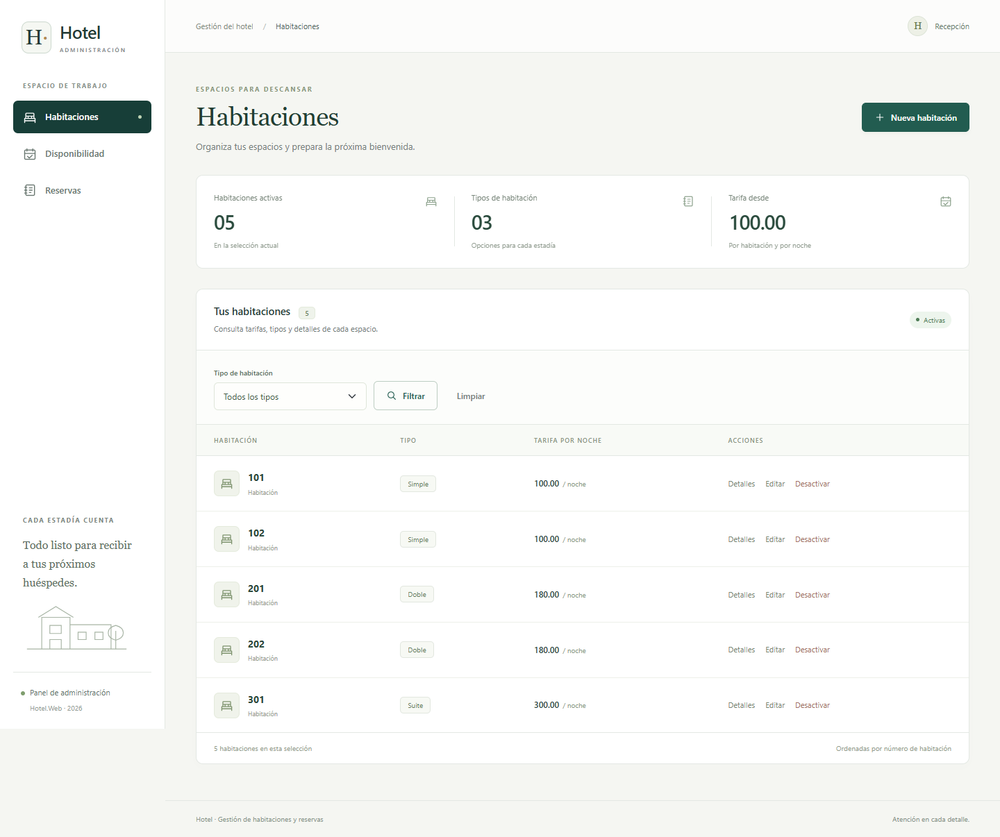

# Hotel Web

Aplicación ASP.NET Core MVC en .NET 10 con Entity Framework Core Database First y SQL Server LocalDB.



## Requisitos

- Windows con .NET SDK 10.
- SQL Server LocalDB o una instancia de SQL Server accesible.
- Visual Studio con la carga de trabajo Desarrollo de ASP.NET y web, o un editor con la CLI de .NET.

## Instalar desde el repositorio

1. Clonar este repositorio y abrir `Hotel.sln`.
2. En una base de práctica nueva, ejecutar `HotelDB.sql` y después `AgregarObservaciones.sql`.
3. Revisar `ConnectionStrings:HotelDB` en `Hotel.Web/appsettings.json` para la instancia de SQL Server utilizada.
4. Desde la raíz del repositorio, ejecutar:

```powershell
dotnet restore Hotel.sln
dotnet build Hotel.sln
dotnet run --project Hotel.Web --launch-profile http
```

Con ese perfil la aplicación abre en `http://localhost:5079`. No se necesitan migraciones ni se ejecutan scripts automáticamente al iniciar.

## Abrir y ejecutar

Abrir `Hotel.sln` en Visual Studio y ejecutar el proyecto `Hotel.Web` con Ctrl+F5.
La base HotelDB ya está creada en `(localdb)\MSSQLLocalDB` en este equipo.
La cadena de conexión está en `Hotel.Web/appsettings.json`.

## Base de datos

`HotelDB.sql` es un esquema de práctica creado a partir de la guía, no el script oficial del docente.
Contiene las cuatro tablas y datos ficticios de prueba. Si el docente entrega otro esquema, ejecutar ese script en una base de práctica y regenerar las entidades; adaptar los repositorios a los nombres resultantes.

En otro equipo, ejecutar primero `HotelDB.sql` y luego `AgregarObservaciones.sql` en SQL Server. No ejecutar de nuevo sobre las tablas existentes.

## Scaffold utilizado

Desde la carpeta `Hotel.Web`:

```powershell
dotnet tool restore
dotnet ef dbcontext scaffold "Server=(localdb)\MSSQLLocalDB;Database=HotelDB;Trusted_Connection=True;TrustServerCertificate=True" Microsoft.EntityFrameworkCore.SqlServer --output-dir Models --context HotelContext --no-onconfiguring
```

Se ejecutó primero sobre la base inicial. Después se agregó Observaciones con `AgregarObservaciones.sql` y se regeneró con:

```powershell
dotnet ef dbcontext scaffold "Server=(localdb)\MSSQLLocalDB;Database=HotelDB;Trusted_Connection=True;TrustServerCertificate=True" Microsoft.EntityFrameworkCore.SqlServer --output-dir Models --context HotelContext --no-onconfiguring --force
```

Las entidades y HotelContext se generaron por scaffold y no se editaron manualmente.

## Funciones

- Habitaciones: filtro por tipo, detalles, alta, edición y baja lógica.
- Disponibilidad: habitaciones activas libres, noches y total estimado mediante una consulta LINQ.
- Reservas: fechas válidas, comprobación de cruces, huéspedes y habitaciones activos, observaciones y estado Pendiente.
- Cancelación mediante POST para reservas Pendiente o Confirmada.
- Repositorios con consultas asíncronas, AsNoTracking para lecturas y guardado asíncrono. Los controladores no acceden al contexto.

El total usa la tarifa actual de la habitación porque la guía no especifica una tarifa histórica en Reserva.

## Entrega académica

Las capturas del diseño están en `Capturas/`, con versiones para escritorio y móvil. Esta carpeta contiene el código y los comandos utilizados. Las observaciones y conclusiones personales deben completarse para la entrega académica.

## Diseño de la aplicación

Navegación lateral con la sección activa, colores verde y marfil, tipografía consistente, resúmenes calculados con los datos mostrados, tablas, etiquetas de estado y formularios con mensajes de validación. En móvil, la navegación pasa a una fila superior y las tablas permiten desplazamiento horizontal. No se necesitan fuentes ni servicios externos para mostrar el diseño.
